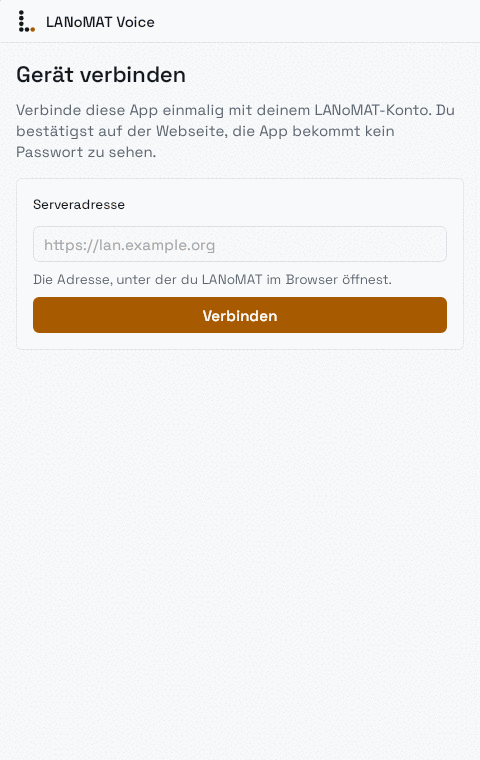
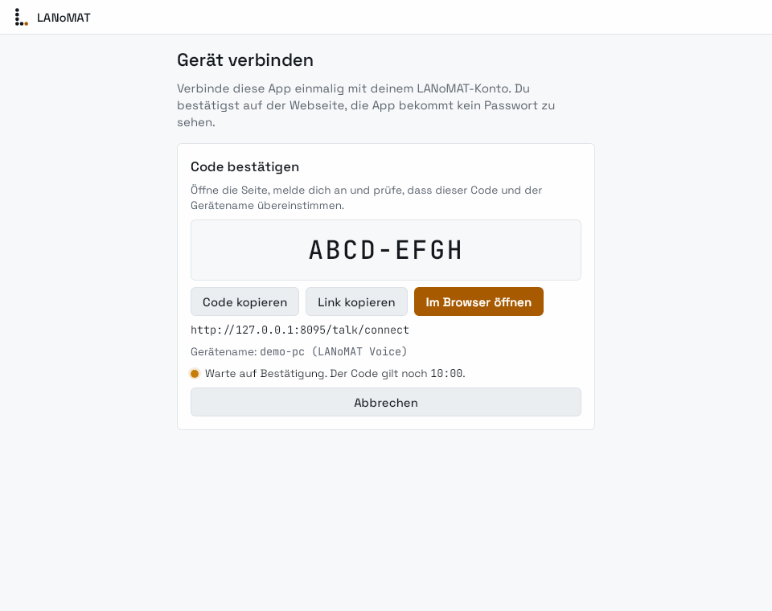
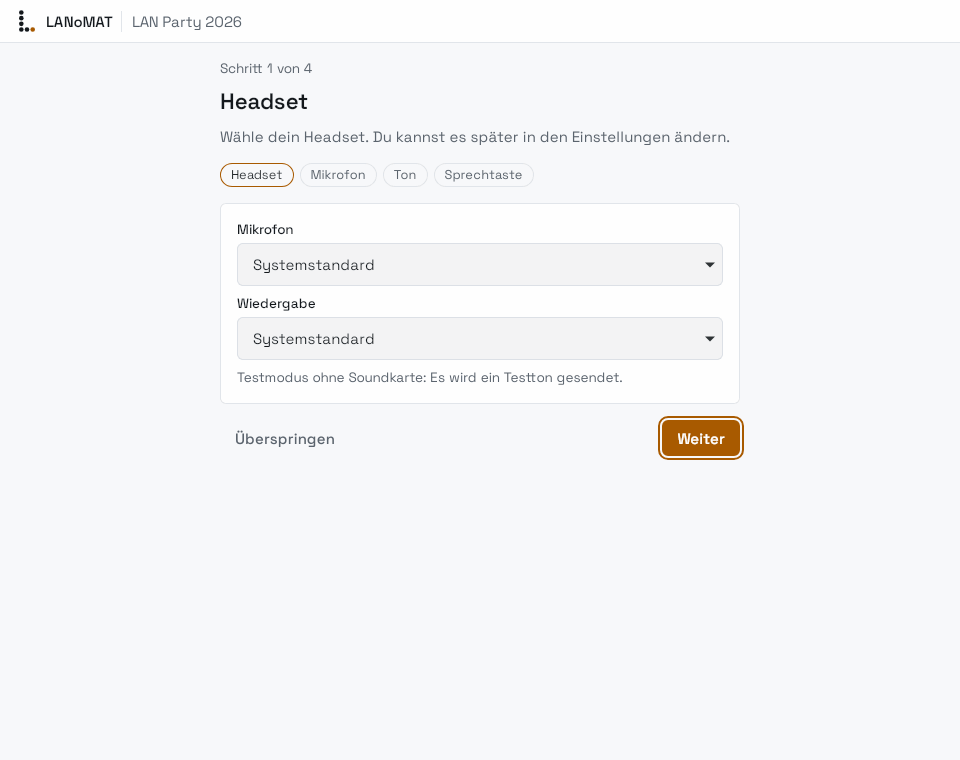
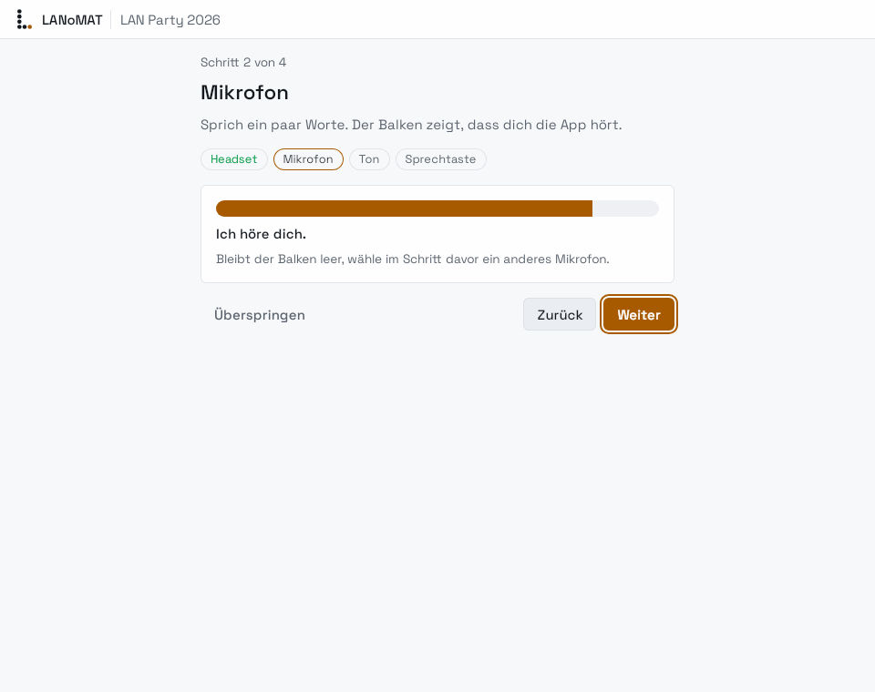
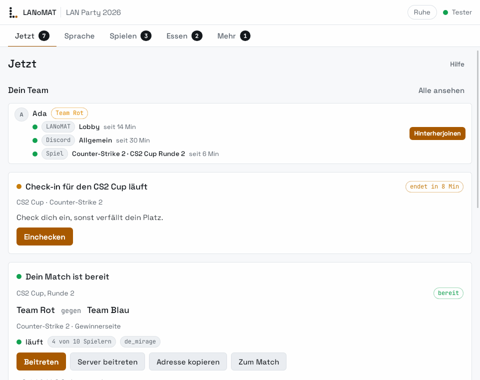
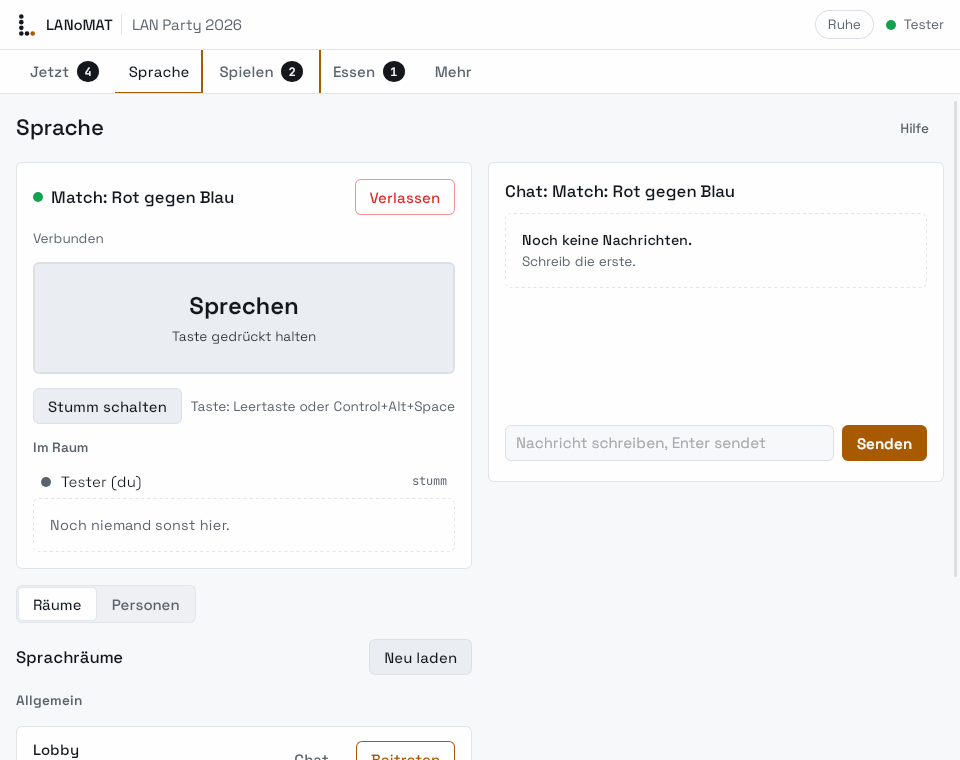
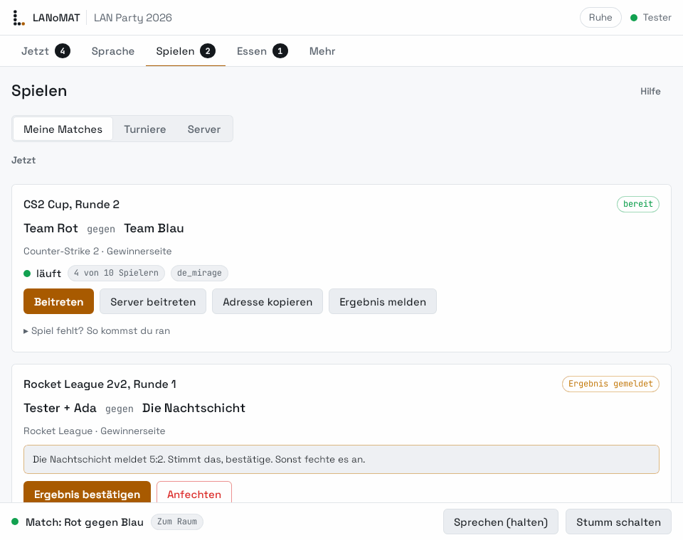
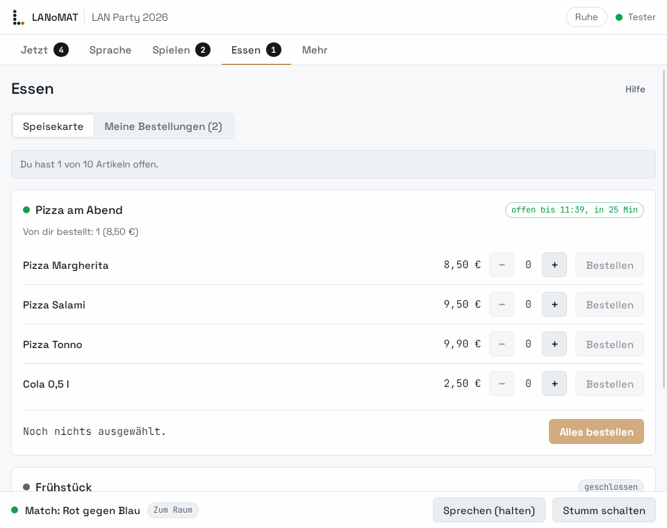
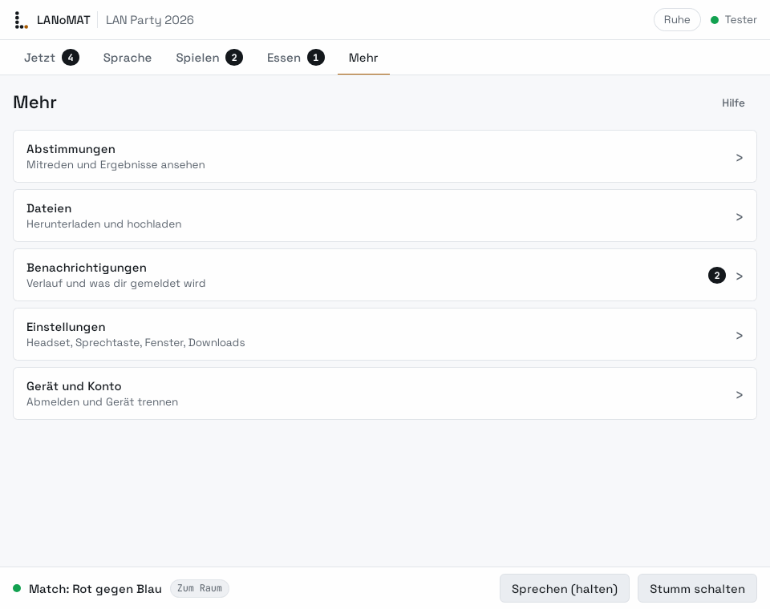
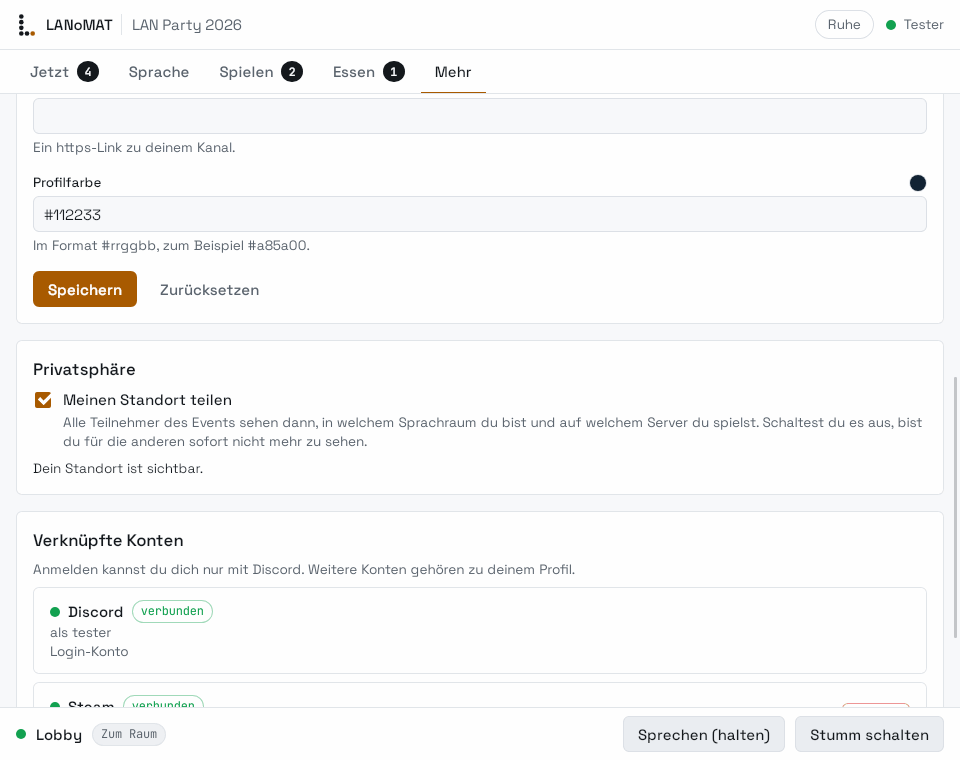

# Die LANoMAT-Desktop-App: Anleitung für Teilnehmer

Die Desktop-App ist dein Begleiter auf der LAN: Sprachchat, Textchat, deine Matches, Essensbestellung,
Abstimmungen und Dateien in einem kleinen Fenster, das neben deinem Spiel läuft. Alles, was die App kann,
geht auch im Browser auf der LANoMAT-Seite. Die App hat aber ein paar Vorteile: du kannst mit einer Taste
sprechen, auch wenn dein Spiel im Vordergrund ist, ein kleines Overlay zeigt dir, wer gerade spricht, und
du siehst auf einen Blick, was als Nächstes für dich ansteht.

## Wo bekomme ich die App?

Du lädst die App direkt in LANoMAT herunter, immer in der Version, die zum Server passt:

- in der Seitenleiste unter **Desktop-App**,
- über die kurze Adresse `/app` (zum Beispiel `https://lan.raute1.org/app`),
- oder direkt auf der Seite `/talk/client`.

Du musst dafür eingeloggt sein. Wähle dein Betriebssystem (Linux oder Windows). Steht auf der Seite
„Version passt nicht zu diesem Server" oder „noch kein Build", frag kurz bei der Orga nach.

## Installieren

### Linux

1. Lade das Archiv `lanomat-voice-app-...-linux-x86_64.tar.gz` herunter.
2. Entpacken: `tar -xzf lanomat-voice-app-*-linux-x86_64.tar.gz`
3. Ausführbar machen und starten: `chmod +x lanomat-voice-app` und dann `./lanomat-voice-app`

Im Archiv liegt eine `LIESMICH.txt`, die auch erklärt, wie du die App ins Startmenü bekommst. Du brauchst
eine aktuelle Distribution mit GTK 3, WebKitGTK 4.1 und PipeWire, PulseAudio oder ALSA.

### Windows

1. Lade die Datei `lanomat-voice-app-...-windows-x86_64.zip` herunter und entpacke sie, zum Beispiel auf
   den Desktop.
2. Starte `LANoMAT-Voice.exe`.

Die Windows-Version ist noch **nicht digital signiert**. Deshalb zeigt Windows beim ersten Start die Meldung
„Der Computer wurde durch Windows geschützt" (SmartScreen). Das ist erwartbar und kein Zeichen für ein
Problem, solange du die Datei von der LANoMAT-Seite hast:

1. Klicke auf **Weitere Informationen**.
2. Klicke auf **Trotzdem ausführen**.

Wenn du ganz sicher gehen willst, vergleiche die Prüfsumme der Datei (`Get-FileHash .\datei.zip` in der
PowerShell) mit dem SHA-256-Wert auf der Download-Seite. Die App braucht die WebView2-Laufzeit; sie ist in
Windows 11 und im aktuellen Windows 10 schon enthalten.

## Erster Start

1. Gib die **Serveradresse** ein (die Adresse, unter der du LANoMAT im Browser öffnest) und klicke auf
   **Verbinden**. Die App zeigt dir einen **Code**; mit **Im Browser öffnen** kommst du direkt zur
   Bestätigungsseite.
2. Im Browser (du bist dort ganz normal mit Discord eingeloggt) prüfst du, dass der Code derselbe ist, und
   bestätigst das Gerät. Die App erkennt das von selbst und geht weiter.





Danach führt dich ein kurzer **Headset-Check** in vier kleinen Schritten durch die Einrichtung. Er dauert
nur einen Moment, und du kannst ihn überspringen oder später in den Einstellungen wiederholen:

1. **Headset** wählen.
2. **Mikrofon** testen: sprich ein paar Worte, der Balken muss ausschlagen.
3. **Ton** testen: die App spielt einen Ton ab.
4. **Sprechtaste** festlegen: mit gedrückter Taste sprechen oder mit offenem Mikrofon.





## Die fünf Tabs

- **Jetzt:** das Wichtigste zuerst, zum Beispiel dein nächstes Match mit „Beitreten", eine laufende
  Abstimmung, deine Bestellung und neue Benachrichtigungen.
- **Sprache:** die Sprachräume (allgemeine Räume und der Raum deines Teams für das Match), daneben der
  Textchat; unter „Personen" siehst du, wer wo ist, und kannst jemandem in den Raum folgen.
- **Spielen:** deine Matches (Ergebnis melden und bestätigen, einchecken), die Turniere, in denen du bist,
  und die Gameserver mit Adresse zum Kopieren.
- **Essen:** die Speisekarte, Bestellung aufgeben und den Stand deiner Bestellungen sehen.
- **Mehr:** Abstimmungen, Dateien (herunterladen und hochladen), Benachrichtigungen, Freunde, dein Profil
  mit verknüpften Konten und die Einstellungen.











Je nachdem, welche Funktionen die Orga für die LAN eingeschaltet hat, fehlen einzelne Tabs oder Einträge.
Das ist so gewollt. Zu jedem Tab gibt es ein kleines **Hilfe**-Blatt.

## Push-to-Talk: sprechen, ohne das Spiel zu verlassen

Standardmäßig startest du stumm und sprichst, solange du die Sprechtaste hältst. Die App kennt zwei Wege:

- **Globale Taste** (Voreinstellung `Strg+Alt+Leertaste`, änderbar in den Einstellungen). Sie funktioniert
  unter Windows und unter X11.
- **Unter Wayland** dürfen Programme keine globalen Tasten abfangen. Dort bindest du die Taste in deinem
  Fenstermanager an zwei Befehle: `lanomat-voice ptt down` beim Drücken und `lanomat-voice ptt up` beim
  Loslassen. Die laufende App nimmt diese Befehle an. Mit `lanomat-voice ptt toggle` schaltest du
  stattdessen um. Beispiele:

```ini
# Hyprland (~/.config/hypr/hyprland.conf): Taste halten zum Sprechen
bind  = , F13, exec, lanomat-voice ptt down
bindr = , F13, exec, lanomat-voice ptt up
```

```text
# i3 oder Sway: Umschalten mit Super+m
bindsym $mod+m exec lanomat-voice ptt toggle
```

Den Befehl `lanomat-voice` bekommst du als zweite Datei (CLI) auf der Download-Seite. Unter Windows kannst du
die Taste mit einem Tool wie AutoHotkey an `lanomat-voice.exe ptt down` und `ptt up` binden.

Mit **Stumm schalten** (Knopf oder Tray-Symbol) sperrst du das Mikrofon komplett, bis du es wieder aufhebst.
Schließt du das Fenster, läuft die App im Tray weiter; beenden kannst du sie im Tray-Menü.

## Datenschutz: „Meinen Standort teilen"

Unter **Sprache > Personen** („Wo ist wer") sehen andere, in welchem Sprachraum du bist, welches Spiel du
spielst und auf welchem Server. Das ist standardmäßig **an**, weil die Funktion nur dann hilft, wenn man sich
findet. Du kannst es jederzeit abschalten: im Tab **Mehr > Profil** den Schalter **Meinen Standort teilen**
ausschalten (er gilt sofort). Dann erscheinst du dort ohne Ort. Dasselbe findest du auch in deinem Profil im
Browser.



Die App speichert dein Zugangs-Token nur auf deinem Gerät. Auf der LANoMAT-Seite
unter `/talk/connect` kannst du im Abschnitt **Verbundene Geräte** jedes Gerät jederzeit trennen.

## Updates

Die App aktualisiert sich nicht selbst. LANoMAT bietet dir immer genau die Version an, die zum Server passt:
Wenn die Orga den Server aktualisiert hat, lädst du die neue App einfach wieder unter **Desktop-App** (`/app`)
herunter und ersetzt die alte. Deine Anmeldung bleibt dabei erhalten.

## Wenn etwas nicht funktioniert

1. **Verbindung prüfen:** Steht oben „offline" oder „Verbindung unterbrochen"? Dann ist der Server nicht
   erreichbar. Prüfe dein WLAN oder Netzwerkkabel und tippe auf „Erneut versuchen".
2. **Gerät neu verbinden:** Melde dich in der App unter **Mehr > Einstellungen > Gerät und Konto** ab, oder
   trenne das Gerät auf `/talk/connect` im Browser unter **Verbundene Geräte**, und verbinde es dann mit
   einem neuen Code.
3. **Neueste Version laden und Orga fragen:** Hol dir die App noch einmal unter `/app`. Hilft das nicht, sag
   der Orga Bescheid und nenne die Version, die du in den Einstellungen siehst, und was du gerade gemacht
   hast. Der Sprachchat läuft im Notfall auch im Browser unter `/talk`.

Kein Ton oder Mikrofon? Wähle in den Einstellungen das richtige Headset und wiederhole den Headset-Check.
