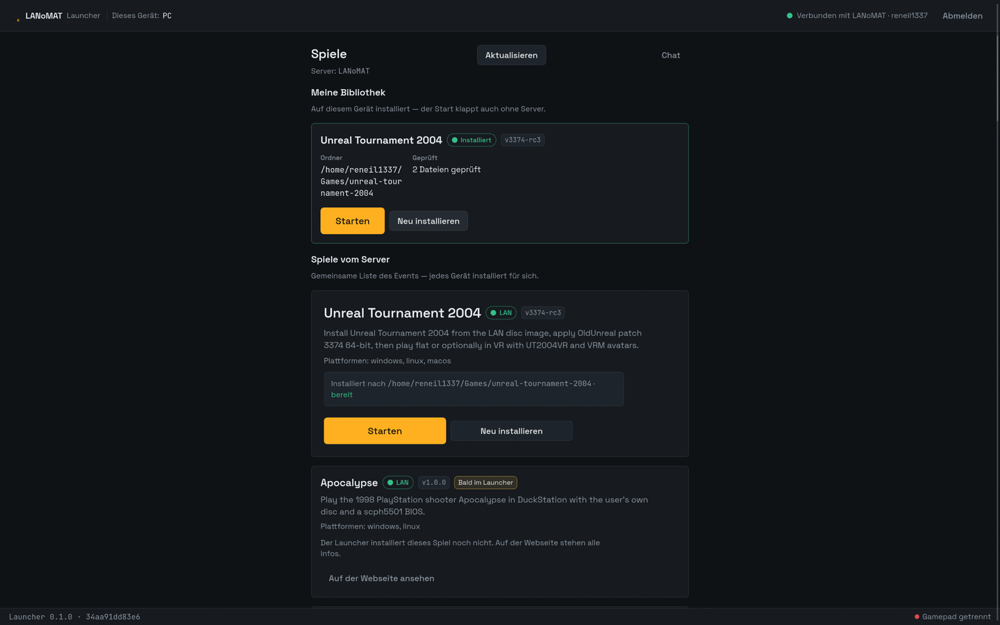
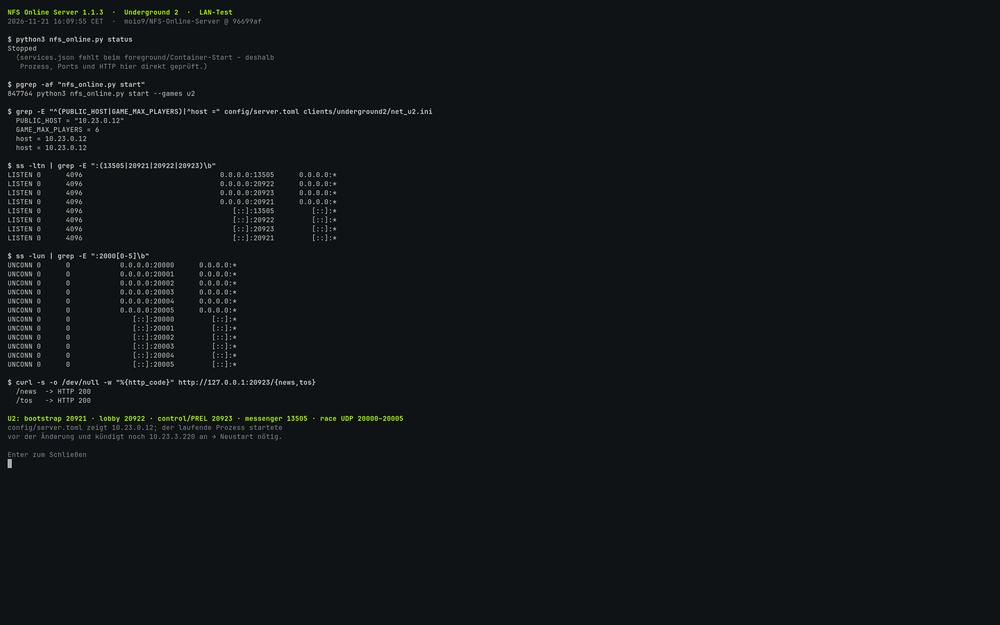

# NFSU2 — Betriebs-Runbook (NFS: Underground 2)

Stand: **2026-11-21**. Dieses Runbook ist der Einstieg für Need for Speed:
Underground 2 auf der LAN. Es bündelt das native Spiel (portables
Windows-Tree + NFS-Online), den Browser-Port `nfsu2.xyz`, den LAN-Server und
die Hosting-Entscheidung. Die Detail-Runbooks stehen am Ende.

**Kurzfassung:** Das Spiel läuft auf Windows direkt und auf Linux über
Wine/Proton. Der LAN-Online-Teil kommt vom Community-Server
[NFS-Online-Server](https://github.com/moio9/NFS-Online-Server) (U2-Ports
20921–20923/tcp, 13505/tcp, 20000–20005/udp). Der Browser-Port
`https://nfsu2.xyz` ist ein unabhängiger Zero-Install-Fallback, **nicht**
unser Server. Das Rezept heißt `need-for-speed-underground-2`; es liegt im
Repo auf `published`, ist live aber noch **draft** und deshalb noch nicht als
Launcher-Karte sichtbar.

## 1. Ziel und Scope

| Ziel | Umsetzung |
| --- | --- |
| Ein Spiel, ein Online-Pfad | NFSU2 1.2 (portabel) + `net_u2.asi` gegen den NFS-Online-Server |
| Windows | `SPEED2.EXE` direkt, Ultimate ASI Loader als `dinput8.dll` |
| Linux | derselbe Windows-Tree über Wine oder Proton; kein natives Build |
| LAN/Online | Bootstrap 20921, Lobby 20922, Control/PREL 20923, Messenger 13505, Race UDP 20000–20005 |
| Browser-Fallback | `https://nfsu2.xyz/` (eigene Spielkopie nicht nötig) |
| Optional | Split-Screen-Mod, 1.2-Patch, Widescreen Fix |
| Nicht im Scope | Retail-Installer, DVD, EA-Account, Carbon/Most Wanted |

Die Spieldateien sind **user-supplied**. Im Repo liegt kein Spiel, kein
Modul und kein Save. Es werden keine Originaldateien verändert; das portable
Paket wird nur entpackt und um ASI-Loader, Client und INI ergänzt.

## 2. Quellen

| Quelle | Rolle | Stand |
| --- | --- | --- |
| [archive.org: `need-for-speed-underground-2_20260707`](https://archive.org/details/need-for-speed-underground-2_20260707) | portables Spiel 1.2, Datei `Need for Speed - Underground 2.zip` | Download 2026-11-21, 2,41 GiB |
| [moio9/NFS-Online-Server](https://github.com/moio9/NFS-Online-Server) | LAN-/Online-Server + Windows-x86-ASI-Client | `96699af`, Version 1.1.3, Classic V958, Client 0.2.22, AGPL-3.0-or-later |
| [ThirteenAG/Ultimate-ASI-Loader](https://github.com/ThirteenAG/Ultimate-ASI-Loader/releases) | lädt `scripts/*.asi` über `dinput8.dll` | NoPDB-Release, Loader **10.0.4** (x86) |
| [th0mk/nfsu2-web](https://github.com/th0mk/nfsu2-web) / [nfsu2.xyz](https://nfsu2.xyz/) | Browser-Port (x86→C→WASM, WebGPU/WebAudio) | letzter Commit `9e02302`, 2026-11-09, Repo archiviert, MIT |
| [mihaits/NFSU2-SplitScreen](https://github.com/mihaits/NFSU2-SplitScreen) | Split-Screen 2–6 Spieler, Port von BirdSentinel (Zack) | `NFSU2SplitScreen-0.14.1-beta`, 2026-11-09 |

Der Browser-Port basiert auf Talha Müderrisoğlus **NFSU2Recomp** (MIT-Stand
vom 2026-10-16) und lädt das Spiel als WebAssembly. Der öffentliche Server
`nfsu2.xyz` hostet seine eigene Spielkopie; Self-Hosting braucht die eigene
v1.2-Kopie und einen Build aus dem archivierten Repo.

## 3. Dateien und Hashes

Alle Werte am 2026-11-21 aus dem lokalen Download gemessen. Der portable
ZIP-Name ist noch irreführend: **`NFSU2-portable.zip` ist derzeit das rohe
archive.org-Archiv**, nicht das fertige LANoMAT-Paket (siehe Abschnitt 9).

| Datei | Größe | SHA-256 | Anmerkung |
| --- | ---: | --- | --- |
| `NFSU2-portable.zip` (rohes Archiv) | 2.593.519.936 B | `0565c4bc372995b770c72763cf734191759fd974344d15b177676180e83bef2e` | 1.393 Einträge, **ein** Wrapper-Ordner `Need for Speed - Underground 2/` |
| `SPEED2.EXE` (v1.2 US) | 4.800.512 B | `f9dd86c054878ce6276beb07c1fd61874f7a1e4bf1f241b084c65b73e24168a7` | exakt die Version, die `nfsu2.xyz` für Self-Host verlangt |
| `net_u2.asi` (Client 0.2.22) | 112.640 B | `8db6557e685cf2dd47f825e62cc202cbace85f6cc4a43af271b8238e0367a04f` | aus `source/client-zig/zig-out/bin/`, PE32 DLL, i386 |
| `net_u2.ini` (LANoMAT-Client) | 606 B | `326b77932af8c280cced1071dfd86f797f450503a18d8b3f851ab0a8d71a43f9` | Host 10.23.0.12 in beiden Sections |
| `dinput8.dll` (Ultimate ASI Loader 10.0.4) | 2.807.520 B | `73d6db0481af99b8481e8e6a685dd385e5a3e0e10518bfe97a993f7f368667eb` | aus `Ultimate-ASI-Loader-NoPDB.zip` |
| `Ultimate-ASI-Loader-NoPDB.zip` | 2.807.520 B (ZIP) | `b329e2b1fec9a64e051f4bac4d5530c6092327a090564db2c25488c47a4865d6` | enthält nur `dinput8.dll` |
| `nfsu2-v12-en-us.zip` | 8.623.211 B (entpackt) | `3306cb5a7881b79b0a66853edf097baf66bb6324702ec9cac76a634ba55703dc` | optionaler 1.2-Patch, enthält `nfsu2_v1.2_us.exe` |
| `NFSU2SplitScreen-0.14.1-beta.zip` | 397.738 B | `b84522b7db060c34fdce4815fb7b87c4d6d3aa43e0968b4844914e8348c81eaf` | Split-Screen-ASI + INI |
| `NFSU2SplitScreen.asi` | 799.232 B | `0247d890dee929c7785f254b44729c9fe0b46d0ab2eefddc4e5f1583ba33348b` | entpackt |
| `WSF.zip` (Widescreen Fix) | 8.832.311 B | `791fcf486db6916642b02a51dd6ed786da7bdbd6c4ad7e207c36ba1f0a5cca59` | optional, `dinput8.dll` + `scripts/` |

Das rohe Archiv bringt bereits eine `dinput8.dll` mit (2.209.280 B,
SHA-256 `51ff8090fd73df83cc18a1957d3d56f73adebf8c9a056653d7cdead3b3498a03`).
Das ist **nicht** unser geprüfter Loader. Für das LAN-Paket wird sie durch
die 10.0.4-Version ersetzt; der Name bleibt `dinput8.dll`.

Hashes im Rezept: Die `requires`-Einträge haben derzeit `sha256: ''`, weil das
portable ZIP pro Build neu gepackt wird. Die Werte oben gelten für **diesen**
Download; ein neues Paket muss neu gehasht werden. Keine erfundenen Hashes.

## 4. Serverports

Der NFS-Online-Server bindet für U2 (`--games u2`) auf `0.0.0.0`:

| Dienst | Proto | Port(s) | Zweck |
| --- | --- | ---: | --- |
| U2 Bootstrap | TCP | `20921` | Serverliste/Bootstrap |
| U2 Lobby/Auth | TCP | `20922` | Login, Lobby, LAN-Directory |
| U2/MW Control + PREL | TCP | `20923` | News, TOS, PREL (`/news`, `/tos`) |
| EA Messenger (Control-Alias) | TCP | `13505` | HTTP-multiplexed |
| Messenger-IPC | TCP | `13506` | nur `127.0.0.1`, nicht freigeben |
| Race Relay | **UDP** | `20000–20005` | ein Kanal pro Fahrer, `GAME_MAX_PLAYERS = 6` |

Most Wanted (`30920/30921/tcp`) und Carbon (`18210/18215/tcp`,
`19119/udp`, `9000/tcp`) sind nur nötig, wenn `--games` sie einschließt.

Firewall-Beispiel für den Event-Host:

```bash
ufw allow 13505/tcp
ufw allow 20921:20923/tcp
ufw allow 20000:20005/udp
```

**Nicht nur 20000/udp freigeben.** Der Relay bindet sechs aufeinanderfolgende
UDP-Ports; bei sechs Fahrern müssen alle erreichbar sein. UDP lässt sich nicht
mit `nc -z` beweisen — im Spiel mit zwei Clients testen.

## 5. Client-INI

Die Datei liegt im Spiel unter `scripts/net_u2.ini`, direkt neben
`scripts/net_u2.asi`. Der Host muss in **beiden** Sections stehen und exakt
die Adresse sein, die der Server als `PUBLIC_HOST` ankündigt.

```ini
[network]
enabled = true
host = 10.23.0.12
bootstrap_port = 20921
lobby_port = 20922
control_port = 20923
control_alias_port = 13505
race_port = 20000

[lan]
enabled = true
host = 10.23.0.12
port = 20922
inject_server = true

[patches]
enabled = true

[logging]
enabled = true
udp_trace = false
```

Der getestete Laptop-Server lief unter `10.23.3.220`; die aktuelle Config und
die Client-INI stehen auf `10.23.0.12` (Event-Ziel). Ein laufender Server
muss nach einer Host-Änderung **neu gestartet** werden, sonst kündigt er noch
die alte Adresse an. Für Online außerhalb des LANs einen DNS-Namen statt der
IP eintragen und `PUBLIC_HOST` identisch setzen.

## 6. Hosting-Entscheidung

| Host | Adresse | Rolle | Bewertung |
| --- | --- | --- | --- |
| **Event-Server** | `10.23.0.12` | **primär fürs Event** | gleiches `/22` wie die Clients, kürzester Weg, Race-UDP bleibt im LAN |
| Laptop (Test) | `10.23.3.220` | getestete Referenz / Fallback | voller Test bestanden, aber WLAN/DHCP/Suspend ungeeignet für Dauerbetrieb |
| Homelab (Unraid) | `100.83.27.66` (Tailnet) | Dauerbetrieb/Lobby, zweite Wahl fürs Racing | 55–150 ms RTT vom Event, Portfreigaben/DynDNS fehlen |
| LANoMAT-App-Server | `46.225.28.53` | optionale öffentliche Instanz nach dem Event | App-Host nicht für Spiel-Ports umbauen |

**Entscheidung:** Der NFS-Online-Server läuft fürs Event auf `10.23.0.12`.
Der Laptop `10.23.3.220` bleibt der getestete Fallback. Der Homelab-Server
ist für Lobby/Accounts geeignet, aber Race-UDP über Tailnet/Pangolin ist
latency-kritisch. Details, Compose und Firewall:
[`nfsu2-server.md`](nfsu2-server.md), Homelab-Messungen:
[`nfsu2-homelab.md`](nfsu2-homelab.md).

## 7. Recipe und Slug

| Feld | Wert |
| --- | --- |
| Nativer Slug | `need-for-speed-underground-2` |
| Rezept | `resources/recipes/need-for-speed-underground-2/{recipe.yaml,SKILL.md}` |
| Repo-Status | `published`, Version `1.2 + NFS Online` |
| Plattformen | `windows`, `linux` |
| Launcher-Support | in `RecipeController::LAUNCHER_SUPPORTED_SLUGS` enthalten |
| Browser-Variante | `need-for-speed-underground-2-browser` (draft, `play_url: https://nfsu2.xyz/`) |
| Lineup | `config/launcher.php` bzw. `LAUNCHER_LINEUP` enthält beide NFSU2-Slugs |

**Live-Stand 2026-11-21 16:10:** Der native Slug ist über die API sichtbar,
aber `status: draft`, `version: null`, `launch_targets: []` und
`installable: false`. Deshalb zeigt die Launcher-Bibliothek noch **keine**
NFSU2-Karte; sichtbar sind nur UT2004 und Apocalypse. Nach Publish/Sync
(04:15) muss die Karte erscheinen. Die Live-Dateien haben noch keine
`lan_match`-Treffer; die portable ZIP muss zuerst auf den Dateihost.

Der Browser-Slug ist noch nicht live. Er hat keine `requires`-Dateien und
würde als „Im Browser starten“ erscheinen.

## 8. Install und Start

### Windows

1. `nfsu2-portable*.zip` nach `C:\Games\NFSU2` entpacken.
2. Den Wrapper-Ordner `Need for Speed - Underground 2/` auflösen, sodass
   `SPEED2.EXE`, `CARS/`, `TRACKS/` und `scripts/` direkt im Ziel liegen.
3. `dinput8.dll` (Ultimate ASI Loader, x86) ins Spielwurzelverzeichnis.
4. `net_u2.asi` und `net_u2.ini` nach `scripts/`.
5. `SPEED2.EXE` starten. Der Loader lädt `scripts/net_u2.asi` automatisch;
   kein Extra-Flag, keine Registry, kein Installer.

### Linux (Wine/Proton)

Es gibt **kein natives Linux-Build**. Der Windows-Tree läuft über Wine oder
Proton; der ASI-Loader braucht zwingend den DLL-Override:

```bash
export WINEDLLOVERRIDES="dinput8=n,b"
wine SPEED2.EXE
```

Auf diesem Laptop ist **kein System-Wine** installiert; getestet wurde
Proton Experimental:

```bash
cd "$HOME/Downloads/nfsu2/game/Need for Speed - Underground 2"
export STEAM_COMPAT_CLIENT_INSTALL_PATH="$HOME/.local/share/Steam"
export STEAM_COMPAT_DATA_PATH="$HOME/Downloads/nfsu2/prefix"
export WINEDLLOVERRIDES="dinput8=n,b"
"$HOME/.steam/steam/steamapps/common/Proton - Experimental/proton" run SPEED2.EXE
```

Das startet bis zum Titelbild und weiter ins Menü/Quick Race (Screenshots
unten). Der `proton`-Befehl aus dem Rezept ist nur vorhanden, wenn ein
Wrapper im `PATH` liegt; sonst den vollen Proton-Pfad nehmen.

### Server starten

```bash
cd NFS-Online-Server
python3 nfs_online.py check
python3 nfs_online.py configure --public-host 10.23.0.12
python3 nfs_online.py start --games u2 --daemon
python3 nfs_online.py status
```

Im Container/foreground-Start fehlt `runtime/services.json`; `status` meldet
dann „Stopped“, obwohl die Ports lauschen. Für die Prüfung zusätzlich
`pgrep -af "nfs_online.py start"`, `ss -ltn`/`ss -lun` und
`curl http://127.0.0.1:20923/news` verwenden.

## 9. Bekannte Blocker

1. **Keine NFSU2-Karte im Launcher.** Das Rezept ist live `draft`
   (`version: null`, `launch_targets: []`). Erst nach Publish und
   Datei-Match erscheint die Karte; der Screenshot unten zeigt den Zustand
   ohne NFSU2.
2. **Das portable ZIP ist noch das rohe Archiv.** Es hat den Wrapper-Ordner,
   `scripts/net_u2.asi`, `scripts/net_u2.ini`, README und Startskript fehlen;
   die enthaltene `dinput8.dll` ist die 2,2-MB-Version des Archivs, nicht
   unser 10.0.4-Loader. Das LANoMAT-Paket muss noch gebaut/hochgeladen werden.
3. **Live-Dateien ohne LAN-Match.** Rezept-`requires` matchen derzeit keine
   freigegebene Datei auf dem Filehost (`lan_match: null`). Ohne Upload bleibt
   `installable: false`.
4. **Host-Mismatch nach Config-Änderung.** `config/server.toml` und
   `clients/underground2/net_u2.ini` stehen auf `10.23.0.12`; der laufende
   Prozess wurde vor der Änderung gestartet und kündigt noch
   `10.23.3.220` an. Server neu starten, sonst finden Clients die Lobby nicht.
5. **`status` lügt beim foreground/Container-Start.** `services.json` wird
   nur vom Daemon-Start geschrieben; „Stopped“ heißt nicht, dass die Ports
   frei sind.
6. **Doppelstart → `Address already in use`.** Nur eine Instanz pro Host und
   Portsatz; ein zweiter `start` scheitert am UDP-Bind (`20000`).
7. **Nur ein UDP-Port reicht nicht.** Der Relay bindet `20000–20005`; alle
   sechs Ports freigeben und im Spiel testen.
8. **`nfsu2.xyz` ist nicht unser Server.** Der Browser-Port ist ein
   unabhängiges öffentliches Deployment mit fremden Spielern, Internetzwang
   und WebGPU-Voraussetzung. Kein LAN-Ersatz, kein NFS-Online-Client.
9. **Split-Screen + Online ist ungetestet.** Beide ASIs patchen das Spiel;
   nicht ungeprüft parallel laden. Split-Screen zuerst allein testen.
10. **Kein voller Online-Renn-Handshake getestet.** Serverports, HTTP und
    UDP-Bind sind geprüft; Login/Lobby/Rennen mit `net_u2.asi` und zwei
    echten Clients stehen noch aus.
11. **Spielversion ist fix.** `SPEED2.EXE` muss 4.800.512 B und
    SHA-256 `f9dd…68a7` sein; andere Versionen laufen im Browser-Self-Host
    nicht und sind auch für den ASI-Pfad nicht getestet.
12. **Browser-Self-Host ist aufwendig.** Kein fertiges Bundle; WASM-Modul
    aus der eigenen Kopie bauen, TLS/DNS/Proxy, ~2 GB Daten. Details in
    [`nfsu2-browser.md`](nfsu2-browser.md).

## 10. Screenshots

Alle Bilder liegen unter `docs/screenshots/nfsu2/` (PNG, ohne Secrets).
Aufgenommen am 2026-11-21 auf dem Event-Laptop (Hyprland/Wayland, 2880×1800,
Skalierung 1.6, `grim`).

| Datei | Zeigt |
| --- | --- |
| [`launcher-library.png`](../screenshots/nfsu2/launcher-library.png) | Launcher-Bibliothek mit UT2004 + Apocalypse; **NFSU2-Karte fehlt noch** (Rezept draft) |
| [`nfs-online-server-status.png`](../screenshots/nfsu2/nfs-online-server-status.png) | `nfs_online.py status`, Prozess, TCP/UDP-Ports, HTTP 200 auf `/news` und `/tos` |
| [`nfsu2-archive-facts.png`](../screenshots/nfsu2/nfsu2-archive-facts.png) | `ls`, SHA-256, 1.393 Dateien und `SPEED2.EXE`-Hash des Downloads |
| [`nfsu2-native-title.png`](../screenshots/nfsu2/nfsu2-native-title.png) | NFSU2-Titelbild nativ über Proton („Press Enter Key“, ExOpts-Hinweis) |
| [`nfsu2-native-quickrace.png`](../screenshots/nfsu2/nfsu2-native-quickrace.png) | Quick Race Car Select im nativen Spiel |
| [`browser-start-page-brave.png`](../screenshots/nfsu2/browser-start-page-brave.png) | `nfsu2.xyz` Startseite in Brave (Ready, Spielerzahlen) |
| [`browser-profile-create-brave.png`](../screenshots/nfsu2/browser-profile-create-brave.png) | Browser-Port nach Play: „Create Profile“ |
| [`browser-intro-chrome.png`](../screenshots/nfsu2/browser-intro-chrome.png) | Browser-Port: Intro/Cutscene (4:3, Letterbox) |

### Launcher-Bibliothek (noch ohne NFSU2)



### NFS-Online-Server



### Natives Spiel über Proton


### Browser-Port


## 11. Weiterführende Runbooks

| Dokument | Inhalt |
| --- | --- |
| [`nfsu2-server.md`](nfsu2-server.md) | Event-Server `10.23.0.12`, Docker-Compose, Ports, Client-Build, Tests |
| [`nfsu2-browser.md`](nfsu2-browser.md) | Browser-Port, WebGPU, Self-Host, Grenzen, Screenshots |
| [`nfsu2-homelab.md`](nfsu2-homelab.md) | Homelab-Test (Unraid), Tailnet/Pangolin, Latenzmessungen, Compose |
| `resources/recipes/need-for-speed-underground-2/` | natives Rezept + Skill |
| `resources/recipes/need-for-speed-underground-2-browser/` | Browser-Rezept (`play_url`) |

## 12. Offene Punkte

- [ ] Rezept live auf `published` setzen und Version/`launch_targets` prüfen;
      danach Launcher-Karte erneut screenshotten.
- [ ] `nfsu2-portable.zip` als flaches LANoMAT-Paket bauen (Wrapper strippen,
      Loader 10.0.4, `scripts/net_u2.asi` + `net_u2.ini`, README/Startskript),
      hashen und auf den Dateihost hochladen.
- [ ] `lan_match` im Rezept prüfen; `installable` muss `true` werden.
- [ ] Server auf `10.23.0.12` neu starten und die angekündigte Adresse im
      Log verifizieren (`advertised as 10.23.0.12`).
- [ ] Zwei echte U2-Clients: Login, Lobby, Race über UDP 20000–20005.
- [ ] Windows-Client mit `dinput8.dll` + `net_u2.asi` end-to-end testen.
- [ ] Split-Screen allein und in Kombination mit Online testen (ASI-Konflikt).
- [ ] Browser-Rezept veröffentlichen oder bewusst draft lassen.
