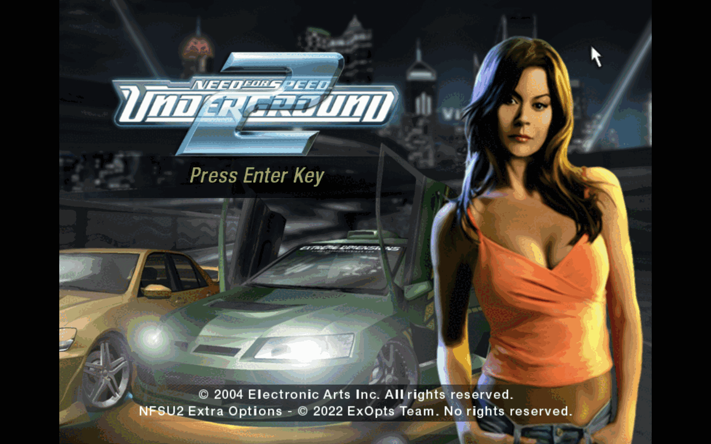
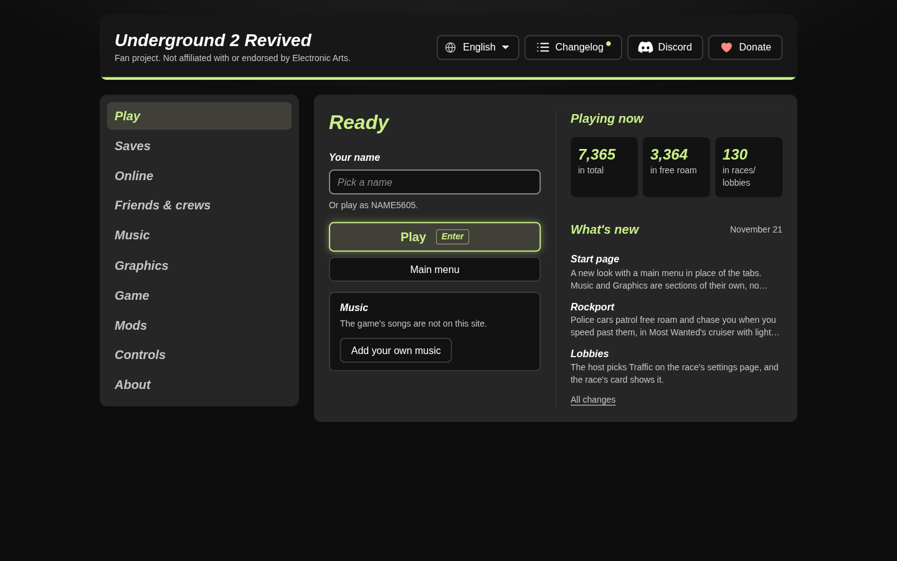

# NFSU2 — Betriebs-Runbook (NFS: Underground 2)

Stand: **2026-11-21**. Dieses Runbook ist der Einstieg für Need for Speed:
Underground 2 auf der LAN. Es bündelt das native Spiel (portables
Windows-Tree + NFS-Online), den Browser-Port `nfsu2.xyz`, den LAN-Server und
die Hosting-Entscheidung. Die Detail-Runbooks stehen am Ende.

**Kurzfassung:** Das Spiel läuft auf Windows direkt und auf Linux über
Wine/Proton. Der LAN-Online-Teil kommt vom Community-Server
[NFS-Online-Server](https://github.com/moio9/NFS-Online-Server) (U2-Ports
20921–20923/tcp, 13505/tcp, 20000–20005/udp). Der Browser-Port
`https://nfsu2.xyz` ist ein unabhängiger Zero-Install-Fallback, **nicht**
unser Server. Das Rezept heißt `need-for-speed-underground-2`; es liegt im
Repo auf `published`, ist live aber noch **draft** und deshalb noch nicht als
Launcher-Karte sichtbar.

## 1. Ziel und Scope

| Ziel | Umsetzung |
| --- | --- |
| Ein Spiel, ein Online-Pfad | NFSU2 1.2 (portabel) + `net_u2.asi` gegen den NFS-Online-Server |
| Windows | `SPEED2.EXE` direkt, Ultimate ASI Loader als `dinput8.dll` |
| Linux | derselbe Windows-Tree über Wine oder Proton; kein natives Build |
| LAN/Online | Bootstrap 20921, Lobby 20922, Control/PREL 20923, Messenger 13505, Race UDP 20000–20005 |
| Browser-Fallback | `https://nfsu2.xyz/` (eigene Spielkopie nicht nötig) |
| Optional | Split-Screen-Mod, 1.2-Patch, Widescreen Fix |
| Nicht im Scope | Retail-Installer, DVD, EA-Account, Carbon/Most Wanted |

Die Spieldateien sind **user-supplied**. Im Repo liegt kein Spiel, kein
Modul und kein Save. Es werden keine Originaldateien verändert; das portable
Paket wird nur entpackt und um ASI-Loader, Client und INI ergänzt.

## 2. Quellen

| Quelle | Rolle | Stand |
| --- | --- | --- |
| [archive.org: `need-for-speed-underground-2_20260707`](https://archive.org/details/need-for-speed-underground-2_20260707) | portables Spiel 1.2, Datei `Need for Speed - Underground 2.zip` | Download 2026-11-21, 2,41 GiB |
| [moio9/NFS-Online-Server](https://github.com/moio9/NFS-Online-Server) | LAN-/Online-Server + Windows-x86-ASI-Client | `96699af`, Version 1.1.3, Classic V958, Client 0.2.22, AGPL-3.0-or-later |
| [ThirteenAG/Ultimate-ASI-Loader](https://github.com/ThirteenAG/Ultimate-ASI-Loader/releases) | lädt `scripts/*.asi` über `dinput8.dll` | NoPDB-Release, Loader **10.0.4** (x86) |
| [th0mk/nfsu2-web](https://github.com/th0mk/nfsu2-web) / [nfsu2.xyz](https://nfsu2.xyz/) | Browser-Port (x86→C→WASM, WebGPU/WebAudio) | letzter Commit `9e02302`, 2026-11-09, Repo archiviert, MIT |
| [mihaits/NFSU2-SplitScreen](https://github.com/mihaits/NFSU2-SplitScreen) | Split-Screen 2–6 Spieler, Port von BirdSentinel (Zack) | `NFSU2SplitScreen-0.14.1-beta`, 2026-11-09 |

Der Browser-Port basiert auf Talha Müderrisoğlus **NFSU2Recomp** (MIT-Stand
vom 2026-10-16) und lädt das Spiel als WebAssembly. Der öffentliche Server
`nfsu2.xyz` hostet seine eigene Spielkopie; Self-Hosting braucht die eigene
v1.2-Kopie und einen Build aus dem archivierten Repo.

## 3. Dateien und Hashes

Alle Werte am 2026-11-21 aus dem lokalen Download gemessen. Zwei Dateien
heißen ähnlich: **`NFSU2-portable.zip`** ist das rohe archive.org-Archiv,
**`nfsu2-portable.zip`** (klein geschrieben) ist das fertige flache
LANoMAT-Paket.

| Datei | Größe | SHA-256 | Anmerkung |
| --- | ---: | --- | --- |
| `nfsu2-portable.zip` (**fertiges Paket**) | 2.602.084.719 B | `0d7028987ba4fdb5dfbd92e3c5a77fd2d6e98992b85b14ef0268fba040767219` | 1.395 Einträge, flach, inkl. Loader/ASI/INI/README/Startskript, `speed.exe` + `SPEED2.EXE` |
| `NFSU2-portable.zip` (rohes Archiv) | 2.593.519.936 B | `0565c4bc372995b770c72763cf734191759fd974344d15b177676180e83bef2e` | 1.393 Einträge, **ein** Wrapper-Ordner `Need for Speed - Underground 2/` |
| `SPEED2.EXE` (v1.2 US) | 4.800.512 B | `f9dd86c054878ce6276beb07c1fd61874f7a1e4bf1f241b084c65b73e24168a7` | exakt die Version, die `nfsu2.xyz` für Self-Host verlangt |
| `net_u2.asi` (Client 0.2.22) | 112.640 B | `8db6557e685cf2dd47f825e62cc202cbace85f6cc4a43af271b8238e0367a04f` | aus `source/client-zig/zig-out/bin/`, PE32 DLL, i386 |
| `net_u2.ini` (LANoMAT-Client) | 606 B | `326b77932af8c280cced1071dfd86f797f450503a18d8b3f851ab0a8d71a43f9` | Host 10.23.0.12 in beiden Sections |
| `dinput8.dll` (Ultimate ASI Loader 10.0.4) | 2.807.520 B | `73d6db0481af99b8481e8e6a685dd385e5a3e0e10518bfe97a993f7f368667eb` | aus `Ultimate-ASI-Loader-NoPDB.zip` |
| `Ultimate-ASI-Loader-NoPDB.zip` | 2.807.520 B (ZIP) | `b329e2b1fec9a64e051f4bac4d5530c6092327a090564db2c25488c47a4865d6` | enthält nur `dinput8.dll` |
| `nfsu2-v12-en-us.zip` | 8.623.211 B (entpackt) | `3306cb5a7881b79b0a66853edf097baf66bb6324702ec9cac76a634ba55703dc` | optionaler 1.2-Patch, enthält `nfsu2_v1.2_us.exe` |
| `NFSU2SplitScreen-0.14.1-beta.zip` | 397.738 B | `b84522b7db060c34fdce4815fb7b87c4d6d3aa43e0968b4844914e8348c81eaf` | Split-Screen-ASI + INI |
| `NFSU2SplitScreen.asi` | 799.232 B | `0247d890dee929c7785f254b44729c9fe0b46d0ab2eefddc4e5f1583ba33348b` | entpackt |
| `WSF.zip` (Widescreen Fix) | 8.832.311 B | `791fcf486db6916642b02a51dd6ed786da7bdbd6c4ad7e207c36ba1f0a5cca59` | optional, `dinput8.dll` + `scripts/` |

Das rohe Archiv bringt bereits eine `dinput8.dll` mit (2.209.280 B,
SHA-256 `51ff8090fd73df83cc18a1957d3d56f73adebf8c9a056653d7cdead3b3498a03`).
Das ist **nicht** unser geprüfter Loader. Für das LAN-Paket wird sie durch
die 10.0.4-Version ersetzt; der Name bleibt `dinput8.dll`.

Hashes im Rezept: Die `requires`-Einträge haben derzeit `sha256: ''`, weil das
portable ZIP pro Build neu gepackt wird. Die Werte oben gelten für **diesen**
Download; ein neues Paket muss neu gehasht werden. Keine erfundenen Hashes.

## 4. Serverports

Der NFS-Online-Server bindet für U2 (`--games u2`) auf `0.0.0.0`:

| Dienst | Proto | Port(s) | Zweck |
| --- | --- | ---: | --- |
| U2 Bootstrap | TCP | `20921` | Serverliste/Bootstrap |
| U2 Lobby/Auth | TCP | `20922` | Login, Lobby, LAN-Directory |
| U2/MW Control + PREL | TCP | `20923` | News, TOS, PREL (`/news`, `/tos`) |
| EA Messenger (Control-Alias) | TCP | `13505` | HTTP-multiplexed |
| Messenger-IPC | TCP | `13506` | nur `127.0.0.1`, nicht freigeben |
| Race Relay | **UDP** | `20000–20005` | ein Kanal pro Fahrer, `GAME_MAX_PLAYERS = 6` |

Most Wanted (`30920/30921/tcp`) und Carbon (`18210/18215/tcp`,
`19119/udp`, `9000/tcp`) sind nur nötig, wenn `--games` sie einschließt.

Firewall-Beispiel für den Event-Host:

```bash
ufw allow 13505/tcp
ufw allow 20921:20923/tcp
ufw allow 20000:20005/udp
```

**Nicht nur 20000/udp freigeben.** Der Relay bindet sechs aufeinanderfolgende
UDP-Ports; bei sechs Fahrern müssen alle erreichbar sein. UDP lässt sich nicht
mit `nc -z` beweisen — im Spiel mit zwei Clients testen.

## 5. Client-INI

Die Datei liegt im Spiel unter `scripts/net_u2.ini`, direkt neben
`scripts/net_u2.asi`. Der Host muss in **beiden** Sections stehen und exakt
die Adresse sein, die der Server als `PUBLIC_HOST` ankündigt.

```ini
[network]
enabled = true
host = 10.23.0.12
bootstrap_port = 20921
lobby_port = 20922
control_port = 20923
control_alias_port = 13505
race_port = 20000

[lan]
enabled = true
host = 10.23.0.12
port = 20922
inject_server = true

[patches]
enabled = true

[logging]
enabled = true
udp_trace = false
```

Der getestete Laptop-Server lief unter `10.23.3.220`; die aktuelle Config und
die Client-INI stehen auf `10.23.0.12` (Event-Ziel). Ein laufender Server
muss nach einer Host-Änderung **neu gestartet** werden, sonst kündigt er noch
die alte Adresse an. Für Online außerhalb des LANs einen DNS-Namen statt der
IP eintragen und `PUBLIC_HOST` identisch setzen.

## 6. Hosting-Entscheidung

| Host | Adresse | Rolle | Bewertung |
| --- | --- | --- | --- |
| **Event-Server** | `10.23.0.12` | **primär fürs Event** | gleiches `/22` wie die Clients, kürzester Weg, Race-UDP bleibt im LAN |
| Laptop (Test) | `10.23.3.220` | getestete Referenz / Fallback | voller Test bestanden, aber WLAN/DHCP/Suspend ungeeignet für Dauerbetrieb |
| Homelab (Unraid) | `100.83.27.66` (Tailnet) | Dauerbetrieb/Lobby, zweite Wahl fürs Racing | 55–150 ms RTT vom Event, Portfreigaben/DynDNS fehlen |
| LANoMAT-App-Server | `46.225.28.53` | optionale öffentliche Instanz nach dem Event | App-Host nicht für Spiel-Ports umbauen |

**Entscheidung:** Der NFS-Online-Server läuft fürs Event auf `10.23.0.12`.
Der Laptop `10.23.3.220` bleibt der getestete Fallback. Der Homelab-Server
ist für Lobby/Accounts geeignet, aber Race-UDP über Tailnet/Pangolin ist
latency-kritisch. Details, Compose und Firewall:
[`nfsu2-server.md`](nfsu2-server.md), Homelab-Messungen:
[`nfsu2-homelab.md`](nfsu2-homelab.md).

## 7. Recipe und Slug

| Feld | Wert |
| --- | --- |
| Nativer Slug | `need-for-speed-underground-2` |
| Rezept | `resources/recipes/need-for-speed-underground-2/{recipe.yaml,SKILL.md}` |
| Repo-Status | `published`, Version `1.2 + NFS Online` |
| Plattformen | `windows`, `linux` |
| Launcher-Support | in `RecipeController::LAUNCHER_SUPPORTED_SLUGS` enthalten |
| Browser-Variante | `need-for-speed-underground-2-browser` (Repo `published`, live noch nicht gelistet, `play_url: https://nfsu2.xyz/`) |
| Lineup | `config/launcher.php` bzw. `LAUNCHER_LINEUP` enthält beide NFSU2-Slugs |

**Live-Stand 2026-11-21 16:18:** Der native Slug ist über die API sichtbar,
aber `status: draft`, `version: null`, `launch_targets: []` und
`installable: false`. Deshalb zeigt die Launcher-Bibliothek noch **keine**
NFSU2-Karte; sichtbar sind nur UT2004 und Apocalypse. Nach Publish/Sync
(04:15) muss die Karte erscheinen. Die Live-Dateien haben noch keine
`lan_match`-Treffer; die portable ZIP muss zuerst auf den Dateihost.

Der Browser-Slug ist noch nicht live. Er hat keine `requires`-Dateien und
würde als „Im Browser starten“ erscheinen.

## 8. Install und Start

### Windows

1. `nfsu2-portable*.zip` nach `C:\Games\NFSU2` entpacken.
2. Den Wrapper-Ordner `Need for Speed - Underground 2/` auflösen, sodass
   `SPEED2.EXE`, `CARS/`, `TRACKS/` und `scripts/` direkt im Ziel liegen.
3. `dinput8.dll` (Ultimate ASI Loader, x86) ins Spielwurzelverzeichnis.
4. `net_u2.asi` und `net_u2.ini` nach `scripts/`.
5. `SPEED2.EXE` starten. Der Loader lädt `scripts/net_u2.asi` automatisch;
   kein Extra-Flag, keine Registry, kein Installer.

### Linux (Wine/Proton)

Es gibt **kein natives Linux-Build**. Der Windows-Tree läuft über Wine oder
Proton; der ASI-Loader braucht zwingend den DLL-Override:

```bash
export WINEDLLOVERRIDES="dinput8=n,b"
wine SPEED2.EXE
```

Auf diesem Laptop ist **kein System-Wine** installiert; getestet wurde
Proton Experimental:

```bash
cd "$HOME/Downloads/nfsu2/game/Need for Speed - Underground 2"
export STEAM_COMPAT_CLIENT_INSTALL_PATH="$HOME/.local/share/Steam"
export STEAM_COMPAT_DATA_PATH="$HOME/Downloads/nfsu2/prefix"
export WINEDLLOVERRIDES="dinput8=n,b"
"$HOME/.steam/steam/steamapps/common/Proton - Experimental/proton" run SPEED2.EXE
```

Das startet bis zum Titelbild und weiter ins Menü/Quick Race (Screenshots
unten). Der `proton`-Befehl aus dem Rezept ist nur vorhanden, wenn ein
Wrapper im `PATH` liegt; sonst den vollen Proton-Pfad nehmen.

Das fertige Paket bringt dafür `start-nfsu2-linux.sh` mit (nimmt `wine`, sonst
`proton run` mit Prefix unter `.proton/`):

```bash
./start-nfsu2-linux.sh
```

Wichtig: **nicht** die nackte `files/bin/wine` aus Proton verwenden. In einem
frischen Prefix fehlen die `libvkd3d-*.dll`; `d3d9.dll` lädt dann nicht und das
Spiel endet mit `c0000135` (getestet 2026-11-21). `proton run` richtet den
Prefix samt vkd3d ein.

### Server starten

```bash
cd NFS-Online-Server
python3 nfs_online.py check
python3 nfs_online.py configure --public-host 10.23.0.12
python3 nfs_online.py start --games u2 --daemon
python3 nfs_online.py status
```

Im Container/foreground-Start fehlt `runtime/services.json`; `status` meldet
dann „Stopped“, obwohl die Ports lauschen. Für die Prüfung zusätzlich
`pgrep -af "nfs_online.py start"`, `ss -ltn`/`ss -lun` und
`curl http://127.0.0.1:20923/news` verwenden.

## 9. Bekannte Blocker

1. **Keine NFSU2-Karte im Launcher.** Das Rezept ist live `draft`
   (`version: null`, `launch_targets: []`), und die live installierte App
   meldet zusätzlich `launcher_supported: false` — sie ist älter als der
   Repo-Code. Erst nach Deploy, Publish und Datei-Match erscheint die Karte;
   der Screenshot unten zeigt den Zustand ohne NFSU2.
2. **Das portable ZIP war bis 2026-11-21 das rohe Archiv.** Erledigt: das
   flache Paket `nfsu2-portable.zip` (2.602.084.719 B, SHA-256 `0d702898…7219`)
   liegt mit Loader 10.0.4, `scripts/net_u2.asi`/`net_u2.ini`, README und
   Linux-Startskript in `/home/reneil1337/Downloads/nfsu2/`. Offen ist nur noch
   der Upload auf den Dateihost.
3. **Live-Dateien ohne LAN-Match.** Rezept-`requires` matchen derzeit keine
   freigegebene Datei auf dem Filehost (`lan_match: null`). Ohne Upload bleibt
   `installable: false`.
4. **Host-Mismatch nach Config-Änderung.** `config/server.toml` und
   `clients/underground2/net_u2.ini` stehen auf `10.23.0.12`; der laufende
   Prozess wurde vor der Änderung gestartet und kündigt noch
   `10.23.3.220` an. Server neu starten, sonst finden Clients die Lobby nicht.
5. **`status` lügt beim foreground/Container-Start.** `services.json` wird
   nur vom Daemon-Start geschrieben; „Stopped“ heißt nicht, dass die Ports
   frei sind.
6. **Doppelstart → `Address already in use`.** Nur eine Instanz pro Host und
   Portsatz; ein zweiter `start` scheitert am UDP-Bind (`20000`).
7. **Nur ein UDP-Port reicht nicht.** Der Relay bindet `20000–20005`; alle
   sechs Ports freigeben und im Spiel testen.
8. **`nfsu2.xyz` ist nicht unser Server.** Der Browser-Port ist ein
   unabhängiges öffentliches Deployment mit fremden Spielern, Internetzwang
   und WebGPU-Voraussetzung. Kein LAN-Ersatz, kein NFS-Online-Client.
9. **Split-Screen + Online ist nur im Load getestet.** Beide ASIs laden in
   einem Prozess (Abschnitt 13), aber ein 2P-Rennen mit `net_u2.asi` wurde
   nicht gefahren. Split-Screen zuerst allein testen.
10. **Kein voller Online-Renn-Handshake getestet.** Serverports, HTTP und
    UDP-Bind sind geprüft; Login/Lobby/Rennen mit `net_u2.asi` und zwei
    echten Clients stehen noch aus.
11. **Spielversion ist fix.** `SPEED2.EXE` muss 4.800.512 B und
    SHA-256 `f9dd…68a7` sein; andere Versionen laufen im Browser-Self-Host
    nicht und sind auch für den ASI-Pfad nicht getestet.
12. **Browser-Self-Host ist aufwendig.** Kein fertiges Bundle; WASM-Modul
    aus der eigenen Kopie bauen, TLS/DNS/Proxy, ~2 GB Daten. Details in
    [`nfsu2-browser.md`](nfsu2-browser.md).

## 10. Screenshots

Alle Bilder liegen unter `docs/screenshots/nfsu2/` (PNG, ohne Secrets).
Aufgenommen am 2026-11-21 auf dem Event-Laptop (Hyprland/Wayland, 2880×1800,
Skalierung 1.6, `grim`).

| Datei | Zeigt |
| --- | --- |
| [`launcher-library.png`](../screenshots/nfsu2/launcher-library.png) | Launcher-Bibliothek mit UT2004 + Apocalypse; **NFSU2-Karte fehlt noch** (Rezept draft) |
| [`nfs-online-server-status.png`](../screenshots/nfsu2/nfs-online-server-status.png) | `nfs_online.py status`, Prozess, TCP/UDP-Ports, HTTP 200 auf `/news` und `/tos` |
| [`nfsu2-archive-facts.png`](../screenshots/nfsu2/nfsu2-archive-facts.png) | `ls`, SHA-256, 1.393 Dateien und `SPEED2.EXE`-Hash des Downloads |
| [`nfsu2-native-title.png`](../screenshots/nfsu2/nfsu2-native-title.png) | NFSU2-Titelbild nativ über Proton („Press Enter Key“, ExOpts-Hinweis) |
| [`nfsu2-native-quickrace.png`](../screenshots/nfsu2/nfsu2-native-quickrace.png) | Quick Race Car Select im nativen Spiel |
| [`browser-start-page-brave.png`](../screenshots/nfsu2/browser-start-page-brave.png) | `nfsu2.xyz` Startseite in Brave (Ready, Spielerzahlen) |
| [`browser-profile-create-brave.png`](../screenshots/nfsu2/browser-profile-create-brave.png) | Browser-Port nach Play: „Create Profile“ |
| [`browser-intro-chrome.png`](../screenshots/nfsu2/browser-intro-chrome.png) | Browser-Port: Intro/Cutscene (4:3, Letterbox) |

### Launcher-Bibliothek (noch ohne NFSU2)


### NFS-Online-Server


### Natives Spiel über Proton



### Browser-Port



## 11. Weiterführende Runbooks

| Dokument | Inhalt |
| --- | --- |
| [`nfsu2-server.md`](nfsu2-server.md) | Event-Server `10.23.0.12`, Docker-Compose, Ports, Client-Build, Tests |
| [`nfsu2-browser.md`](nfsu2-browser.md) | Browser-Port, WebGPU, Self-Host, Grenzen, Screenshots |
| [`nfsu2-homelab.md`](nfsu2-homelab.md) | Homelab-Test (Unraid), Tailnet/Pangolin, Latenzmessungen, Compose |
| `resources/recipes/need-for-speed-underground-2/` | natives Rezept + Skill |
| `resources/recipes/need-for-speed-underground-2-browser/` | Browser-Rezept (`play_url`) |

## 12. Offene Punkte

- [ ] Rezept live auf `published` setzen und Version/`launch_targets` prüfen;
      danach Launcher-Karte erneut screenshotten.
- [x] `nfsu2-portable.zip` als flaches LANoMAT-Paket bauen (Wrapper strippen,
      Loader 10.0.4, `scripts/net_u2.asi` + `net_u2.ini`, README/Startskript),
      hashen — erledigt, Test unter Proton Experimental bestanden.
- [ ] `nfsu2-portable.zip` auf den Dateihost hochladen und `sha256` ins
      Rezept eintragen.
- [ ] `lan_match` im Rezept prüfen; `installable` muss `true` werden.
- [ ] Server auf `10.23.0.12` neu starten und die angekündigte Adresse im
      Log verifizieren (`advertised as 10.23.0.12`).
- [ ] Zwei echte U2-Clients: Login, Lobby, Race über UDP 20000–20005.
- [ ] Windows-Client mit `dinput8.dll` + `net_u2.asi` end-to-end testen.
- [ ] Split-Screen allein und in Kombination mit Online testen (ASI-Konflikt).
- [ ] Browser-Rezept veröffentlichen oder bewusst draft lassen.

## 13. Split-Screen (optional, Stand 2026-11-21)

**Kurzfassung:** `mihaits/NFSU2-SplitScreen` ist ein optionaler ASI-Mod für
lokalen Couch-Splitscreen (2–6 Spieler an **einem** PC). Er lädt neben
`net_u2.asi` im selben `scripts/`-Ordner, ohne Dateinamen-Kollision; im Test
initialisierten beide ASIs in einem Prozess und das Hauptmenü baute den
Eintrag **Split-Screen**. Ein volles 2P-Rennen wurde auf dem Testlaptop nicht
gefahren (kein Gamepad). Empfehlung: als optionalen `mod` aufnehmen
(`required: false`), nicht als Standard.

| Punkt | Wert |
| --- | --- |
| Quelle | [mihaits/NFSU2-SplitScreen](https://github.com/mihaits/NFSU2-SplitScreen) |
| Release | `v0.14.1-beta`, 2026-11-09 (Beta, MIT) |
| Asset | `NFSU2SplitScreen-0.14.1-beta.zip`, 397.738 B, sha256 `b84522b7db060c34fdce4815fb7b87c4d6d3aa43e0968b4844914e8348c81eaf` |
| Inhalt | `NFSU2SplitScreen.asi` 799.232 B, sha256 `0247d890dee929c7785f254b44729c9fe0b46d0ab2eefddc4e5f1583ba33348b`; `NFSU2SplitScreen.ini` 3.713 B, sha256 `92ee3ccc1070ca54385c20ea5c66ebc441109de41fa4a8284e3e25d3ba661095` |
| Ablage | `Downloads/nfsu2/mods/splitscreen/` (ZIP + entpackt), Testbaum `Downloads/nfsu2/test-split/` |
| Spieler | 2–6 lokal (Repo-Kurzbeschreibung nennt noch „2–4“; README/Release: 2–6) |
| Nicht enthalten | keine DLL, kein Loader, keine Registry, kein Installer |

**Voraussetzungen**

- `SPEED2.EXE` **v1.2**, exakt 4.800.512 B. Das portable Basispaket passt:
  sha256 `f9dd86c054878ce6276beb07c1fd61874f7a1e4bf1f241b084c65b73e24168a7`.
  Andere Versionen lehnt der Mod mit einer MessageBox ab (`IsExeV12`) und
  installiert nichts.
- ASI-Loader: das Basispaket bringt `dinput8.dll` (Ultimate ASI Loader,
  sha256 `51ff8090fd73df83cc18a1957d3d56f73adebf8c9a056653d7cdead3b3498a03`)
  und WidescreenFix mit. Wine braucht weiterhin
  `WINEDLLOVERRIDES=dinput8=n,b`.
- WidescreenFix ist **empfohlen** (freie Kamera pro Spieler) und liegt im
  Basispaket (`scripts/NFSUnderground2.WidescreenFix.asi`).
- Extra Options ist unkritisch, solange
  `ExperimentalSplitScreenFix = 0` bleibt (im Basispaket bereits 0). Steht es
  auf 1, warnt der Mod per MessageBox.
- Unlimiter ist laut Mod-Autoren kompatibel und im Basispaket enthalten.
- **XtendedInput entfernen**: nicht nötig, läuft nicht zusammen (der Mod liest
  XInput selbst und hat eigene Keybinds pro Spieler).

**Installation** (kein Build nötig)

1. `NFSU2SplitScreen.asi` und `NFSU2SplitScreen.ini` nach `{{target}}/scripts/`
   kopieren (neben `net_u2.asi`).
2. Für Fehlersuche `Debug = 1` in der INI; dann schreibt der Mod
   `scripts/NFSU2SplitScreen.log` (plus `NFSU2SplitScreen_crash*.txt/.dmp`).
3. Start wie bisher über `SPEED2.EXE`; im Hauptmenü erscheint der Eintrag
   **Split-Screen** direkt beim Quick-Race-Menü.

**Koexistenz mit NFS-Online (`net_u2.asi`)**

- Beide sind eigenständige `*.asi` in `scripts/`; es gibt keine gemeinsame
  DLL und keinen Namenskonflikt. Der Loader lädt alphabetisch:
  `net_u2.asi` → `NFSU2ExtraOptions.asi` → `NFSU2SplitScreen.asi` →
  `NFSU2Unlimiter.asi` → `NFSUnderground2.WidescreenFix.asi`. `net_u2`
  patcht damit zuerst, Split-Screen hängt sich dahinter (der Mod chaint
  fremde Hooks an Funktionsstarts und Call-Sites).
- Getestet mit Client 0.2.22 (`net_u2.asi`, 112.640 B) in einem Prozess:
  Log zeigt `installed plugin: net_u2.asi`, danach alle Split-Screen-
  Relocations; `net_u2` meldet `U2 base patches installed` und
  `U2 LAN injection installed`; das Hauptmenü baut den Eintrag
  (`split icon: stock`) – kein Absturz beim Laden.
- **Grenze:** Split-Screen ist lokal. Er ersetzt keine LAN-Lobby; ob ein
  Online-Rennen parallel zum Splitscreen sinnvoll ist, ist ungetestet. Für
  die LAN heißt das: Splitscreen-PC = Couch-Station, nicht „mehrere
  LAN-Spieler pro Rechner“.

**Proton/Wine**

- Getestet mit **Proton Experimental (wine 11.0)**, frisches Prefix,
  `STEAM_COMPAT_DATA_PATH` + `WINEDLLOVERRIDES=dinput8=n,b`, WidescreenFix
  `WindowedMode = 4`. Das Spiel startet, lädt beide ASIs und erreicht das
  Frontend mit ~120 fps (2880×1800-Testfenster).
- Autorenangabe: bis 4 Spieler mit GE-Proton über Lutris getestet; 5–6
  Spieler unter Linux nicht getestet.
- Linux-Pads: DualSense/DS4 nativ (hidraw-uaccess-Regel), Xbox-BT-
  Impulstrigger brauchen die udev-Regel aus
  [docs/linux.md](https://github.com/mihaits/NFSU2-SplitScreen/blob/main/docs/linux.md);
  Steam Input für PlayStation-Pads abschalten, sonst gehen Lightbar,
  Trigger und Speaker verloren.

**Testprotokoll 2026-11-21 (dieser Laptop, Intel Arc, Omarchy)**

| Schritt | Ergebnis |
| --- | --- |
| ZIP-Hash | `NFSU2-portable.zip` md5 `8386b637e9ea5ac6f98d9704b04b28bc` (archive.org) ✔ |
| Exe-Erkennung | `SPEED2.EXE` 4.800.512 B, v1.2 akzeptiert, Mod installiert ✔ |
| ASI-Load | `net_u2.asi` + `NFSU2SplitScreen.asi` (+ ExtraOptions, Unlimiter, WSF) in einem Prozess ✔ |
| Menüeintrag | `split icon: stock (Quick Race icon 128 wide)` = Split-Screen-Eintrag gebaut ✔ |
| 2P-Rennen | **nicht gefahren** (kein Gamepad am Laptop; P2 braucht START am Pad) |
| Stabilität | 2. Lauf: > 7 min im Frontend ohne Absturz; 1. Lauf: ein Crash nach 718 s im Frontend (s. u.) |

**Beobachteter Crash (nicht reproduziert, nicht zugeordnet)**

- 1. Lauf, 718 s nach Load, `exception C0000005 at 0046568A SPEED2.EXE+6568A`,
  `read 0DCCBF7F`, mode 2 / state 3, Stack mit Frames aus
  `NFSU2ExtraOptions.asi` und `NFSU2SplitScreen.asi`.
- Kontext: im Frontend wurden per Skript wiederholt Enter-Tasten ans
  Splash/FMV geschickt; parallel liefen weitere Spiele auf demselben
  Desktop (CPU/GPU-Last). Artefakte:
  `Downloads/nfsu2/test-split/scripts/NFSU2SplitScreen_crash_20261121_160606.{txt,dmp}`.
- Ein zweiter Lauf mit identischem Setup lief > 7 min im Frontend stabil.
  Vor einer Paket-Freigabe daher **ein echter 2P-Splitscreen-Lauf** auf
  Windows **und** unter Proton, je einmal mit und ohne `net_u2.asi`.

**Konfiguration, die LAN-Spieler typischerweise ändern**

| INI-Schlüssel | Default | Wirkung |
| --- | --- | --- |
| `VerticalSplit` | 0 | 2P nebeneinander (1) statt übereinander (0) |
| `PadSpeakers` / `PadSpeakerGain` | 1 / 400 | Motorsound auf DualSense-/DS4-Lautsprecher |
| `Rumble` / `RumbleStrength` | 1 / 100 | Rumble pro Pad |
| `AdaptiveTriggers` / `TriggerStrength` | 1 / 100 | DualSense-/Xbox-Trigger |
| `GaugeScalePercent` | 60 | Tacho-Größe pro Spieler |
| `ExtraPlayers` | 0 | Default der Players-Zeile (2 + n) |
| `Debug` | 0 | 1 = Log + Crash-Dumps + Debug-Mailbox |

**Risiken / Abbau**

- Beta-Stand; bekannte Bugs im Repo (`docs/open-issues.md`), u. a.
  Boot-Hänger mit WidescreenFix im Exclusive-Fullscreen (mit
  `WindowedMode = 4` nicht gesehen) und Stutter bei gemischten
  Monitor-Refresh-Raten.
- Jeder Spieler ab P2 braucht einen eigenen Controller; P1 kann Tastatur
  sein. Ohne Pads lässt sich kein 2P-Rennen starten.
- Alle Spieler teilen Profil/Garage; Keybinds landen in
  `scripts/NFSU2SplitScreen_Players.ini`.
- Abbau: die zwei Dateien aus `scripts/` löschen; Save und `net_u2.asi`
  bleiben unberührt.

**Rezept-Block (Vorschlag, `role: mod`, optional)**

```yaml
    - role: mod
      label: 'NFSU2 Split Screen 0.14.1 beta (optional, local 2-6 players)'
      match: ['NFSU2SplitScreen-*.zip', 'NFSU2SplitScreen.asi']
      required: false
      sha256: 'b84522b7db060c34fdce4815fb7b87c4d6d3aa43e0968b4844914e8348c81eaf'
      url: https://github.com/mihaits/NFSU2-SplitScreen/releases/download/v0.14.1-beta/NFSU2SplitScreen-0.14.1-beta.zip
      notes: 'MIT. Optional couch mode only: 2-6 local players on one PC, not a LAN mode. Copy NFSU2SplitScreen.asi + NFSU2SplitScreen.ini into {{target}}/scripts/ next to net_u2.asi (no DLL, no installer). Needs SPEED2.EXE v1.2 (4,800,512 B); WidescreenFix/Ultimate ASI Loader provides the loader. Verified 2026-11-21 with Proton Experimental (wine 11.0): net_u2.asi and the plugin load in one process and the Split-Screen menu entry appears. Keep Extra Options ExperimentalSplitScreenFix = 0 and remove XtendedInput. Each player from P2 needs a gamepad.'
```

## 14. Client-Start unter Proton Experimental (Ende-zu-Ende, 2026-11-21)

Getestet auf `10.23.3.220` (Intel iGPU, Wayland/Hyprland 0.56, emulierte
Auflösung 2880×1800 @1.6). Ziel war die Frage: **startet der U2-Client mit
`net_u2.asi` unter Proton, und sieht der Server den Login?** Antwort: ja,
bis in die Online-Lobby (`auth ok`, `pers ok`, EA-Messenger verbunden,
`gsea`/`game_search`).

### 14.1 Artefakt und Spielstand

| Prüfung | Ergebnis |
| --- | --- |
| ZIP | `NFSU2-portable.zip`, 2.593.519.936 B, `unzip -t` → *No errors detected* (1.393 Einträge/1.292 Dateien) |
| SHA-256 ZIP | `0565c4bc372995b770c72763cf734191759fd974344d15b177676180e83bef2e` |
| Top-Level | `SPEED2.EXE`, `CARS/`, `TRACKS/`, `scripts/`, `SOUND/`, `FRONTEND/`, `GLOBAL/`, `NIS/`, `MOVIES/`, `SAVE/`, `LANGUAGES/`, `pfdata/`, `memcard/`, `SDATA.Backup/` |
| Haupt-EXE | **`SPEED2.EXE`** (nicht `speed.exe` – das ist NFSU1), 4.800.512 B, PE32/i386/GUI, ImageBase `0x400000`, Build-Zeitstempel 2005-03-09 01:37 |
| SHA-256 EXE | `f9dd86c054878ce6276beb07c1fd61874f7a1e4bf1f241b084c65b73e24168a7` |
| Version | Retail **1.2**-Generation (Größe 4.800.512 B = 1.2-Build; der Client erwartet genau diesen Stand). Keine PE-Versionsressource im EXE → Version nur über Größe/Hash/Signaturen bestimmbar. |
| Schon gepatcht? | Ja: 1.2-Stand + No-CD-fähiger Repack (`filelist.txt`, `unins000.*`, `NFSU2Fix.sdb`). Zusätzlich vorinstallierte ASI-Mods in `scripts/` (WidescreenFix, Extra Options, Unlimiter, Split-Screen). Spieldaten (`CARS/`, `TRACKS/`) unverändert. |
| 1.2-Patch nötig? | Nur wenn man eine 1.0/1.1-CD-Installation nutzt. `net_u2.asi` patcht per Signatursuche **und** über feste RVAs (`0xf3040`, `0x350160`, `0x34b7e0`, `0x34b870`, `0x343aa0`, `0x343a50`, `0x140a60`, `0xe8a00`); alle 8 Adressen liegen in diesem EXE auf plausiblen Funktionsprologen, alle 4 Signatur-Patterns matchen. Offizielle Quellen für 1.2: `nfsug2v1-2us.exe`/`nfsug2v1-2uk.exe` (EA, via archive.org) bzw. das fertige `nfsu2_v1.2_us.zip` im archive.org-Item `nfsug-2-disk-1_20251007`. |

### 14.2 ASI-Loader und Plugin-Installation

```bash
GAME="$HOME/Downloads/nfsu2/game/Need for Speed - Underground 2"
# 1) Ultimate ASI Loader als dinput8-Proxy ins Root (der Repack bringt bereits
#    einen mit; PDB-Pfad "WidescreenFixesPack\Ultimate-ASI-Loader\bin\Win32\Release\dinput8.pdb")
cp dinput8.dll "$GAME/"                       # Ultimate-ASI-Loader v10.0.4 (NoPDB); im Test wurde der mitgelieferte Loader benutzt
# 2) net_u2 bauen (Zig 0.16.0) und neben die Mods legen
cd source/client-zig && ZIG=/pfad/zu/zig ./build_linux.sh
cp zig-out/bin/net_u2.asi zig-out/bin/net_u2.ini "$GAME/scripts/"
```

Gebaut mit Client-Version **0.2.22** (`source/client-zig/VERSION`), Zig 0.16.0,
`-Doptimize=ReleaseSmall`; `net_u2.asi` = 112.640 B,
SHA-256 `8db6557e685cf2dd47f825e62cc202cbace85f6cc4a43af271b8238e0367a04f`,
PE-Audit (`tools/audit_pe.py`) OK.

Hinweis zum Build im Quellbaum: `tools/check_ports.py` vergleicht
`source/client-zig/config/net_u2.ini` byteweise mit `clients/underground2/net_u2.ini`.
Sobald dort eine LAN-IP eingetragen ist, bricht das Skript ab – für den Test
reicht `zig build -Doptimize=ReleaseSmall` + `tools/audit_pe.py`.

Der Loader lädt alle `*.asi` aus dem Spiel-Root und aus `scripts/`. Ladereihenfolge
in der Praxis (Log des Split-Screen-Plugins): `NFSU2ExtraOptions.asi` →
`NFSU2SplitScreen.asi` → `NFSU2Unlimiter.asi` → `NFSUnderground2.WidescreenFix.asi`,
dazu `net_u2.asi`; alle fünf in **einem** Prozess, keine Kollision beobachtet.

### 14.3 Exakter Startbefehl (Proton Experimental)

```bash
export STEAM_COMPAT_CLIENT_INSTALL_PATH="$HOME/.steam/steam"
export STEAM_COMPAT_DATA_PATH="$HOME/Downloads/nfsu2/proton-prefix-u2"   # eigener Prefix
export WINEDLLOVERRIDES="dinput8=n,b"
export PROTON_USE_WINED3D=1        # nur für den UI-Test nötig, siehe 14.5
cd "$HOME/Downloads/nfsu2/game/Need for Speed - Underground 2"
"$HOME/.local/share/Steam/steamapps/common/Proton - Experimental/proton" run ./SPEED2.EXE
```

Getestet mit **Proton Experimental 11.0-20261105c** (`files/bin/wine --version` →
`wine-11.0`), Prefix frisch (`pfx`), kein winetricks, kein Steam-Client nötig.
Der Prefix liegt bewusst außerhalb von `steamapps/compatdata`; `proton run`
initialisiert ihn beim ersten Start selbst.

Ergebnis: Spiel startet, DXVK initialisiert (`2880×1800` bzw. `1024×768`
Swapchain), Intro läuft, Hauptmenü erreichbar.

### 14.4 Server und Client-INI für den Test

Der Homelab-/Standard-Portblock (20921/20922/20923/13505, UDP 20000-20005) war
im Test bereits belegt, deshalb eine zweite Instanz auf eigenen Ports – gleiche
Software, gleiche Konfigurationsstruktur:

```bash
rsync -a --exclude .git NFS-Online-Server/ "$HOME/Downloads/nfsu2/nfs-test-server/"
cd "$HOME/Downloads/nfsu2/nfs-test-server"
# config/server.toml: PUBLIC_HOST=127.0.0.1, LISTEN/PUBLIC_PORT
# 21021/21022/21023, Messenger 13515, Race-Relay 21000, DLC-Store 8082
python3 nfs_online.py check
python3 nfs_online.py start --games u2 --daemon
python3 nfs_online.py account create u2probe3 --persona u2probe3 --password 'aaaaa'
```

`scripts/net_u2.ini` (nur Ports/Host geändert, Rest wie ausgeliefert):

```ini
[network]
enabled = true
host = 127.0.0.1
bootstrap_port = 21021
lobby_port = 21022
control_port = 21023
control_alias_port = 13515
race_port = 21000
[lan]
enabled = true
host = 127.0.0.1
port = 21022
inject_server = true
[patches]
enabled = true
[logging]
enabled = true
udp_trace = false
```

Client-Log (`scripts/net_u2-trace-<pid>.log`) nach dem Start:

```text
net_u2 0.2.22 U2 single-port identity wrapper initialization thread entered
net_u2 network=true bootstrap=127.0.0.1:21021 lobby=127.0.0.1:21022 control=127.0.0.1:21023 alias=127.0.0.1:13515 race=127.0.0.1:21000
net_u2 lan=true lobby=127.0.0.1:21022 control=127.0.0.1:20923 alias=127.0.0.1:13505 inject=true
U2 base patches installed
U2 LAN injection installed
```

### 14.5 Nachweis: Client erreicht den Server

Menüweg im Spiel: `Main Menu → Online (3. Kachel) → Terms of Service (kommt vom
Server!) → Agree → EA Login → Use Existing EA Account → u2probe3/aaaaa →
Save EA Login? No → Select An Online Persona → u2probe3 → Online Main Menu`.
Die ToS-Seite („NFS Online community server terms of use … not affiliated with
Electronic Arts“) wird also schon vor dem Login vom lokalen Server geladen.

Server-Log (`logs/classic.log`, Auszug; vollständig in
`~/Downloads/nfsu2/evidence/server-log-excerpt.txt`):

```text
16:51:05 bootstrap client connected: peer=127.0.0.1:34826
16:51:05 secure bootstrap RSA accepted
16:51:05 secure bootstrap established peer_echo=ok
16:51:05 stock bootstrap command=@tic payload_len=11
16:51:05 stock directory reply challenge=yes secure=True lobby=127.0.0.1:21022
16:51:05 lobby client connected: peer=127.0.0.1:41728 challenge=yes
16:51:05 lobby command=addr/skey/news/sele
16:54:42 lobby command=auth result=ok
16:55:13 lobby command=pers result=ok
16:55:13 EA Messenger client connected: peer=127.0.0.1:33552
16:55:13 EA Messenger dialect selected: adapter=underground2-classic-messenger
16:55:13 lobby command=user / auxi
16:56:04 lobby command=gsea result=game_search
```

Damit ist die Kette Bootstrap → Directory → Lobby → Auth → Persona →
EA-Messenger → Spielsuche durchgängig belegt. Ein **Rennen** (UDP-Relay
21000-21005) wurde nicht gefahren; der Rechner hatte nur einen Client.

Screenshots (außerhalb des Repos, `~/Downloads/nfsu2/evidence/`):
`03-mainmenu.png` (Hauptmenü), `07-login3.png` (ToS vom Server),
`20-tos.png`, `29-form2.png` (Login-Formular), `44-online-menu.png` /
`45-online-menu2.png` (Online Main Menu), `47-lobby.png`.

### 14.6 Bekannte Fehler und Workarounds

| Symptom | Ursache | Workaround |
| --- | --- | --- |
| Fenster schwarz/friert ein, Menü reagiert nicht | DXVK/D3D9-Swapchain im Vordergrund-Only-Modus; sobald das Fenster auf einen anderen Hyprland-Workspace wandert oder ein anderes Spiel Vollbild hat, kommen keine Frames mehr | Fenster sichtbar + fokussiert halten; für den UI-Test `PROTON_USE_WINED3D=1` (OpenGL, überlebt Fokuswechsel besser). Auf einem normalen Desktop ohne parallele Spiele tritt das nicht auf. |
| `EXCEPTION handling: System.ComponentModel.Win32Exception: Invalid window handle` + sofortiger Exit | Start direkt nach dem Abschießen einer früheren Instanz (Prefix/Wineserver noch nicht fertig) | 3-5 s warten, `wineserver -k` im Prefix, `pfx.lock` löschen, erneut starten |
| Tastatur wirkt tot (Pfeile/Enter), Maus markiert aber | XWayland-Fokus liegt nicht auf dem Spiel (Fenster verdeckt/nicht aktiv) | Fenster erst fokussieren (`hyprctl dispatch 'hl.dsp.focus{window="address:0x…"}'`), dann Keys senden; synthetische Events vorher prüfen |
| `Enter` bestätigt Dialoge nicht, `KP_Enter` schon | Eigenheit der U2-Dialoge unter Wine (Return wird z. T. verschluckt) | `KP_Enter` (Numpad-Enter) senden |
| Passwort im EA-Login zu kurz → `auth result=bad_password` | zu schnelles synthetisches Tippen; Zeichen fallen weg (Feld zeigt weniger `*` als getippt) | langsam tippen (≥300 ms/Zeichen) und Sterne zählen; notfalls kurzes Testpasswort |
| Mausklicks treffen daneben | U2 nutzt relatives Maus-Handling in XWayland; `XTestFakeMotionEvent`-Absolutkoordinaten werden als Delta interpretiert | erste Klick nur fokussiert, zweiter Klick trifft; oder komplett per Tastatur navigieren |
| `Address already in use` beim Serverstart | anderer U2-Server belegt 20921-20923/20000 | zweite Instanz auf eigenen Ports starten (siehe 14.4) |

**Fehlende DLLs:** keine. Der Repack läuft ohne `vcrun*`, ohne `d3dx9_*`
(DXVK liefert D3D9; mit `PROTON_USE_WINED3D=1` übernimmt WineD3D/OpenGL).
`dinput8.dll` im Root ist der ASI-Loader, kein echtes DirectInput – mit
`WINEDLLOVERRIDES=dinput8=n,b` wird er garantiert nativ geladen.

**Save:** liegt im Prefix unter
`pfx/drive_c/users/steamuser/Documents/NFS Underground 2/` (Profil `reneil1337`
wurde dort angelegt, „Load complete.“ beim zweiten Start). Ein 100-%-Save wurde
nicht getestet; das Profil muss vor dem Online-Login existieren, sonst zeigt das
Spiel zuerst „Create Profile“.

**Aufräumen:** Testserver `python3 nfs_online.py stop` im
`nfs-test-server`-Verzeichnis; Spiel/Prefix können bleiben (kein Repo-Anteil).


### 14.9 Screenshot index (repo)

- `docs/screenshots/nfsu2/nfsu2-native-mainmenu.png` — native NFSU2 main menu
- `docs/screenshots/nfsu2/nfsu2-native-online-menu.png` — Online menu after bootstrap
- `docs/screenshots/nfsu2/nfsu2-native-lobby.png` — lobby/auth flow
- `docs/screenshots/nfsu2/nfsu2-native-tos.png` — community ToS from the server
- `docs/screenshots/nfsu2/nfsu2-native-title.png` / `nfsu2-native-quickrace.png` — title and Quick Race
